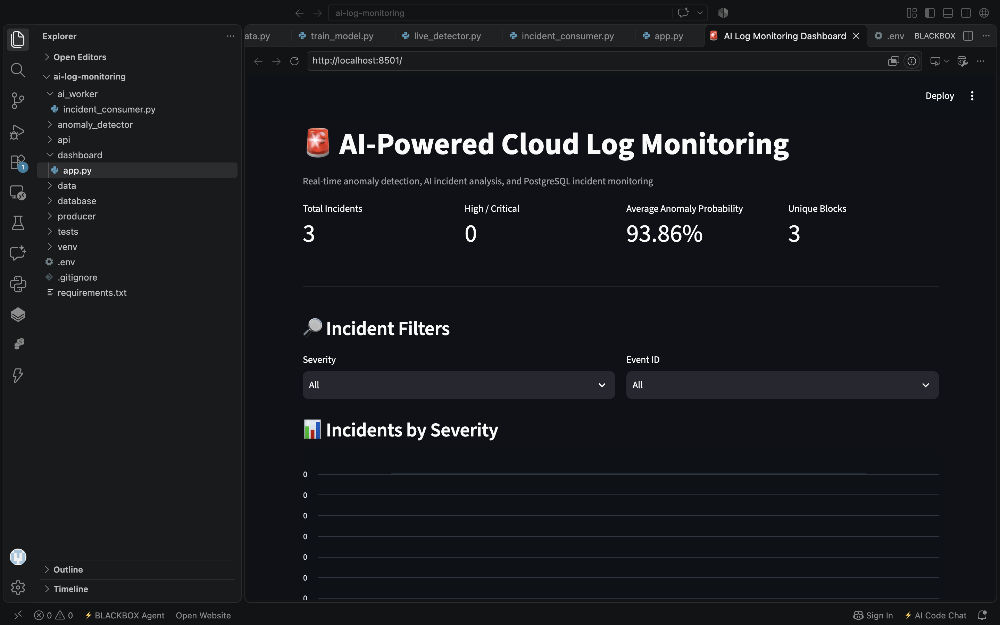
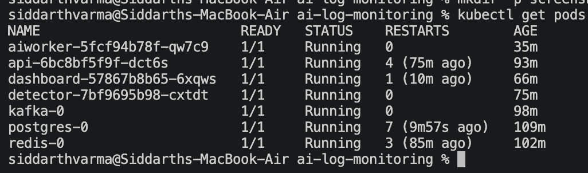
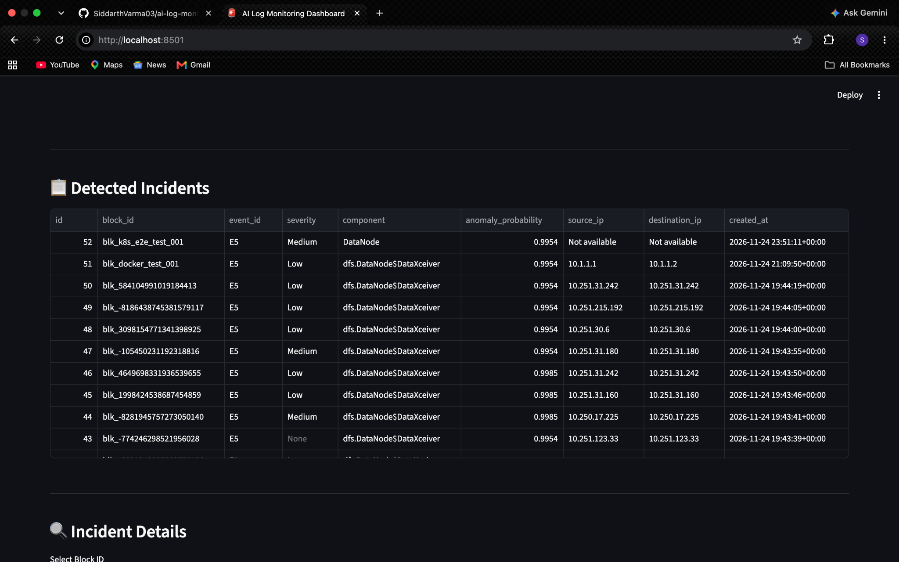
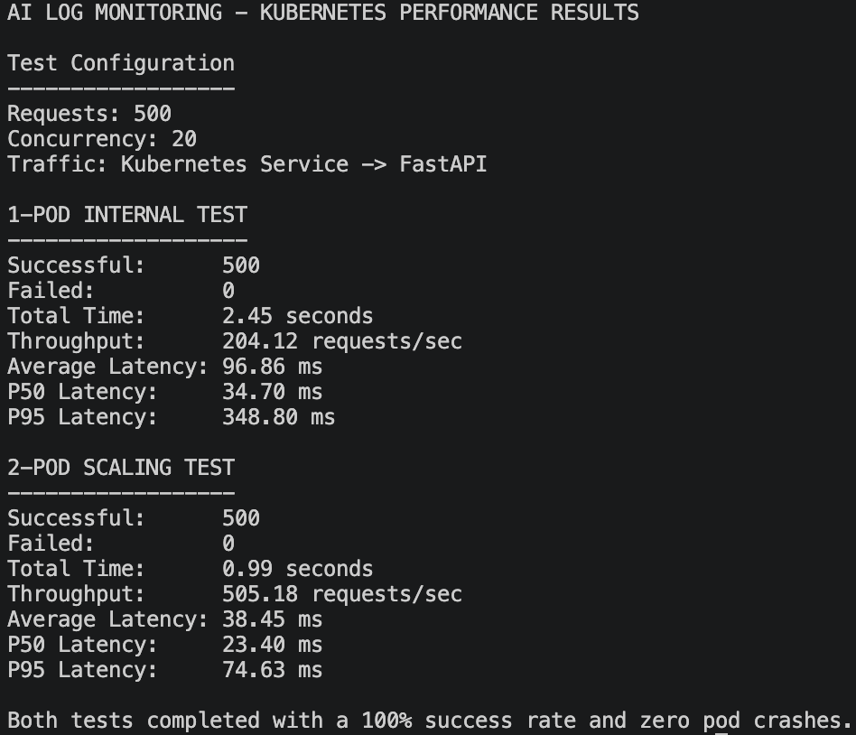

# AI-Powered Cloud Log Monitoring and Incident Detection Service

A distributed cloud-native log monitoring system that ingests system logs in real time, streams them through Apache Kafka, detects anomalies using machine learning, generates AI-assisted incident explanations using Google Gemini, stores incidents in PostgreSQL, prevents duplicate processing with Redis, and visualizes results through a live Streamlit dashboard.

The complete application was containerized using Docker and successfully deployed and tested on a local Kubernetes cluster.

---

## Project Overview

Modern distributed systems generate large volumes of logs, making it difficult to manually identify failures and abnormal behavior.

This project builds an automated log-monitoring pipeline that:

1. Receives application/system logs through a FastAPI REST API.
2. Publishes logs to Apache Kafka.
3. Uses a trained machine-learning model to detect anomalous behavior.
4. Sends detected incidents to a separate Kafka topic.
5. Uses Google Gemini to generate a readable incident explanation.
6. Stores incidents in PostgreSQL.
7. Uses Redis to prevent duplicate incident processing.
8. Displays incidents and system metrics in a Streamlit dashboard.
9. Runs the complete distributed architecture using Kubernetes.

---

## Architecture


### End-to-End Flow

```text
HDFS Logs
   ↓
Live Producer
   ↓
FastAPI
   ↓
Kafka: application-logs
   ↓
ML Anomaly Detector
   ↓
Kafka: detected-incidents
   ↓
Gemini AI Worker
   ↓
PostgreSQL + Redis
   ↓
Streamlit Dashboard
```

---

## Technology Stack

| Component | Technology |
|---|---|
| Programming Language | Python |
| REST API | FastAPI |
| Streaming Platform | Apache Kafka |
| Machine Learning | scikit-learn |
| ML Model | Logistic Regression |
| AI Incident Analysis | Google Gemini |
| Database | PostgreSQL |
| Cache / Deduplication | Redis |
| Dashboard | Streamlit |
| Containerization | Docker |
| Multi-container Deployment | Docker Compose |
| Orchestration | Kubernetes |
| Kubernetes Monitoring | Metrics Server |
| Dataset | Loghub HDFS Logs |

---

## Main Features

- Real-time log ingestion using FastAPI
- Apache Kafka event streaming
- Machine-learning anomaly detection
- Logistic Regression model with balanced class weights
- 19 Event-ID-based model features
- Separate Kafka topic for detected incidents
- AI-generated incident summaries using Gemini
- Severity classification
- Likely-cause generation
- Recommended corrective actions
- Source and destination IP extraction
- PostgreSQL incident persistence
- Redis duplicate incident prevention
- Live Streamlit dashboard
- Dockerized application services
- Docker Compose orchestration
- Kubernetes deployment
- Persistent Kubernetes storage
- Readiness and liveness health checks
- Kubernetes resource monitoring
- Horizontal API scaling
- Load and performance testing

---

## Project Structure

```text
ai-log-monitoring/
│
├── ai_worker/
│   └── incident_consumer.py
│
├── anomaly_detector/
│   ├── model/
│   │   ├── event_features.pkl
│   │   └── logistic_regression_model.pkl
│   ├── consumer.py
│   ├── inspect_training_data.py
│   ├── live_detector.py
│   └── train_model.py
│
├── api/
│   └── main.py
│
├── dashboard/
│   └── app.py
│
├── data/
│   ├── HDFS_2k_structured.csv
│   └── training/
│       ├── HDFS_100k.log_structured.csv
│       └── anomaly_label.csv
│
├── k8s/
│   ├── aiworker.yaml
│   ├── api.yaml
│   ├── configmap.yaml
│   ├── dashboard.yaml
│   ├── detector.yaml
│   ├── kafka.yaml
│   ├── postgres.yaml
│   └── redis.yaml
│
├── producer/
│   ├── live_producer.py
│   ├── live_producer_100k.py
│   └── read_hdfs.py
│
├── screenshots/
│   ├── 01-dashboard-overview.png
│   ├── 02-kubernetes-pods.png
│   ├── 03-detected-incidents.png
│   ├── 04-end-to-end-test.png
│   └── 05-performance-results.png
│
├── Dockerfile.api
├── Dockerfile.detector
├── Dockerfile.aiworker
├── Dockerfile.dashboard
├── docker-compose.yml
├── requirements.txt
├── .dockerignore
└── .gitignore
```

---

# Dataset

The project uses the public HDFS log dataset from Loghub.

The training data contains structured HDFS system events and block-level anomaly labels.

The model-training workflow produced:

- 104,815 structured log events
- 7,940 unique HDFS block IDs
- 101,544 normal events
- 3,271 anomalous events

The final anomaly detector uses 19 Event-ID features:

```text
E10
E11
E13
E14
E15
E16
E18
E2
E21
E22
E25
E26
E27
E3
E5
E6
E7
E8
E9
```

---

# Machine Learning

The anomaly detector uses:

```text
LogisticRegression(
    max_iter=1000,
    class_weight="balanced"
)
```

The model is trained using structured Event IDs extracted from HDFS logs.

The trained model and event-feature list are stored inside:

```text
anomaly_detector/model/
```

The live detector consumes Kafka messages from:

```text
application-logs
```

It aggregates events by block ID and performs anomaly prediction after receiving enough events for the block.

When an anomaly is detected, the incident is published to:

```text
detected-incidents
```

---

# AI Incident Analysis

The AI worker consumes detected incidents from Kafka and sends them to Google Gemini.

Gemini generates structured incident information containing:

```text
Summary
Severity
Component
Event ID
Block ID
Source IP
Destination IP
Anomaly Probability
Likely Cause
Recommended Action
```

Example:

```text
Summary:
A PacketResponder exception occurred while transferring a block between DataNodes.

Severity:
Medium

Component:
DataNode

Likely Cause:
A network or transmission error occurred during the PacketResponder block transfer.

Recommended Action:
Check network connectivity and DataNode logs between the involved nodes.
```

The incident is then stored in PostgreSQL.

Redis stores the processed block ID so duplicate detections for the same block are skipped.

---

# PostgreSQL Incident Storage

The incident table uses the following structure:

```sql
CREATE TABLE incidents (
    id BIGSERIAL PRIMARY KEY,
    block_id VARCHAR(100),
    event_id VARCHAR(50),
    log_level VARCHAR(20),
    component VARCHAR(255),
    events_seen INTEGER,
    anomaly_probability DOUBLE PRECISION,
    source_ip VARCHAR(45),
    destination_ip VARCHAR(45),
    summary TEXT,
    severity VARCHAR(20),
    likely_cause TEXT,
    recommended_action TEXT,
    raw_message TEXT,
    created_at TIMESTAMPTZ DEFAULT CURRENT_TIMESTAMP
);
```

---

# Redis Deduplication

Redis prevents the AI worker from processing the same anomalous block repeatedly.

Processed blocks are stored using keys such as:

```text
processed_block:blk_5727159100405160712
```

Before calling Gemini, the worker checks whether the block already exists in Redis.

If it exists:

```text
Skipping duplicate incident for block
```

If it does not exist, the incident is analyzed, stored in PostgreSQL, and then marked as processed in Redis.

---

# Streamlit Dashboard

The Streamlit dashboard provides a live operational view of detected incidents.

The dashboard includes:

- Total incident count
- High/Critical incident count
- Average anomaly probability
- Unique affected blocks
- Severity filters
- Event ID filters
- Severity distribution chart
- Incident table
- Individual incident details
- AI-generated summary
- Likely cause
- Recommended action
- Raw log message

The dashboard automatically refreshes every few seconds.

---

# Environment Variables

Create a local `.env` file in the project root.

Example:

```text
GEMINI_API_KEY=your_api_key

POSTGRES_HOST=localhost
POSTGRES_PORT=5432
POSTGRES_DB=logmonitoring
POSTGRES_USER=logadmin
POSTGRES_PASSWORD=your_password

REDIS_HOST=localhost
REDIS_PORT=6379
```

The real `.env` file is excluded from Git using `.gitignore`.

Do not commit API keys or passwords.

---

# Python Setup

Create the Python virtual environment:

```bash
python3 -m venv venv
```

Activate it:

```bash
source venv/bin/activate
```

Install dependencies:

```bash
pip install -r requirements.txt
```

---

# Docker

Four application Docker images are used:

```text
Dockerfile.api
Dockerfile.detector
Dockerfile.aiworker
Dockerfile.dashboard
```

The application services are:

```text
FastAPI
ML Detector
AI Worker
Streamlit Dashboard
```

The stateful infrastructure services are:

```text
Kafka
PostgreSQL
Redis
```

---

# Docker Compose

The complete local distributed architecture can be managed using Docker Compose.

Start the stack:

```bash
docker compose up -d
```

Check containers:

```bash
docker compose ps
```

Stop the stack:

```bash
docker compose stop
```

FastAPI is exposed on:

```text
http://localhost:8000
```

FastAPI health check:

```bash
curl http://localhost:8000/health
```

Expected response:

```json
{"status":"healthy"}
```

The Streamlit dashboard is available at:

```text
http://localhost:8501
```

---

# Kubernetes Deployment

The complete application was deployed successfully on a local Kubernetes cluster.

A separate namespace was used:

```text
ai-log-monitoring
```

Create the namespace:

```bash
kubectl create namespace ai-log-monitoring
```

Set it as the active namespace:

```bash
kubectl config set-context --current --namespace=ai-log-monitoring
```

---

## Kubernetes Configuration

Apply the ConfigMap:

```bash
kubectl apply -f k8s/configmap.yaml
```

Create the secret separately so credentials are not committed to Git:

```bash
kubectl create secret generic ai-log-secrets \
  --from-literal=GEMINI_API_KEY="YOUR_GEMINI_API_KEY" \
  --from-literal=POSTGRES_PASSWORD="YOUR_POSTGRES_PASSWORD"
```

---

## Deploy PostgreSQL

```bash
kubectl apply -f k8s/postgres.yaml
```

Verify:

```bash
kubectl get pods
kubectl get pvc
```

---

## Deploy Redis

```bash
kubectl apply -f k8s/redis.yaml
```

Test Redis:

```bash
kubectl exec redis-0 -- redis-cli ping
```

Expected:

```text
PONG
```

---

## Deploy Kafka

```bash
kubectl apply -f k8s/kafka.yaml
```

Create the application logs topic:

```bash
kubectl exec kafka-0 -- \
/opt/kafka/bin/kafka-topics.sh \
--create \
--topic application-logs \
--bootstrap-server kafka:29092 \
--partitions 1 \
--replication-factor 1
```

Create the detected incidents topic:

```bash
kubectl exec kafka-0 -- \
/opt/kafka/bin/kafka-topics.sh \
--create \
--topic detected-incidents \
--bootstrap-server kafka:29092 \
--partitions 1 \
--replication-factor 1
```

Verify:

```bash
kubectl exec kafka-0 -- \
/opt/kafka/bin/kafka-topics.sh \
--list \
--bootstrap-server kafka:29092
```

Expected topics:

```text
application-logs
detected-incidents
```

---

## Deploy FastAPI

```bash
kubectl apply -f k8s/api.yaml
```

---

## Deploy ML Detector

```bash
kubectl apply -f k8s/detector.yaml
```

Detector logs:

```bash
kubectl logs deployment/detector
```

Expected startup:

```text
ML model loaded
Loaded 19 event features
Live Anomaly Detector started
Kafka server: kafka:29092
Waiting for application logs...
```

---

## Deploy AI Worker

```bash
kubectl apply -f k8s/aiworker.yaml
```

Check logs:

```bash
kubectl logs deployment/aiworker
```

Expected:

```text
Redis connected
AI Worker started
Waiting for detected incidents...
```

---

## Deploy Dashboard

```bash
kubectl apply -f k8s/dashboard.yaml
```

---

# Verify Kubernetes Deployment

Run:

```bash
kubectl get pods
```

The deployed architecture contains:

```text
aiworker
api
dashboard
detector
kafka
postgres
redis
```

All components were successfully tested with:

```text
READY: 1/1
STATUS: Running
```

---

# Access the Kubernetes Application

Forward the FastAPI service:

```bash
kubectl port-forward service/api 8000:8000
```

Forward the dashboard:

```bash
kubectl port-forward service/dashboard 8501:8501
```

Open:

```text
http://localhost:8501
```

---

# End-to-End Kubernetes Test

A complete Kubernetes pipeline test was performed using a new block:

```text
blk_k8s_e2e_test_001
```

The test generated an anomalous `E5` DataNode event.

The ML detector produced:

```text
Prediction: ANOMALY
Anomaly Probability: 0.9954
```

The incident was then:

1. Published to Kafka.
2. Received by the AI worker.
3. Analyzed by Gemini.
4. Saved to PostgreSQL.
5. Registered in Redis.
6. Displayed in the Streamlit dashboard.

PostgreSQL verification:

```text
block_id: blk_k8s_e2e_test_001
event_id: E5
severity: Medium
anomaly_probability: 0.9954
```

Redis verification:

```text
processed_block:blk_k8s_e2e_test_001
processed
```

This confirmed the complete pipeline:

```text
FastAPI
→ Kafka
→ ML Detector
→ Kafka
→ Gemini
→ PostgreSQL
→ Redis
→ Dashboard
```

---

# Kubernetes Monitoring

Kubernetes Metrics Server was installed to monitor CPU and memory usage.

Example baseline resource usage:

| Service | CPU | Memory |
|---|---:|---:|
| AI Worker | 10m | 61Mi |
| API | 12m | 44Mi |
| Dashboard | 43m | 128Mi |
| Detector | 17m | 132Mi |
| Kafka | 55m | 563Mi |
| PostgreSQL | 25m | 19Mi |
| Redis | 25m | 16Mi |

The Kubernetes node baseline was approximately:

```text
CPU: 11%
Memory: 62%
```

---

# Performance Testing

The FastAPI service was load tested from inside Kubernetes.

Test configuration:

```text
Total Requests: 500
Concurrency: 20
Traffic Path: Kubernetes Service → FastAPI
```

Two tests were performed:

1. One FastAPI pod
2. Two FastAPI pods

---

## One API Pod

```text
Total Requests : 500
Successful     : 500
Failed         : 0
Total Time     : 2.45 seconds
Throughput     : 204.12 requests/sec
Average Latency: 96.86 ms
P50 Latency    : 34.70 ms
P95 Latency    : 348.80 ms
```

---

## Two API Pods

```text
Total Requests : 500
Successful     : 500
Failed         : 0
Total Time     : 0.99 seconds
Throughput     : 505.18 requests/sec
Average Latency: 38.45 ms
P50 Latency    : 23.40 ms
P95 Latency    : 74.63 ms
```

---

## Scaling Comparison

| Metric | 1 API Pod | 2 API Pods |
|---|---:|---:|
| Requests | 500 | 500 |
| Successful | 500 | 500 |
| Failed | 0 | 0 |
| Total Time | 2.45 s | 0.99 s |
| Throughput | 204.12 req/s | 505.18 req/s |
| Average Latency | 96.86 ms | 38.45 ms |
| P50 Latency | 34.70 ms | 23.40 ms |
| P95 Latency | 348.80 ms | 74.63 ms |
| Pod Crashes | 0 | 0 |

Horizontal scaling significantly improved system performance.

Throughput increased from:

```text
204.12 requests/sec
```

to:

```text
505.18 requests/sec
```

while average latency dropped from:

```text
96.86 ms
```

to:

```text
38.45 ms
```

Both tests completed with:

```text
100% success rate
0 failed requests
0 pod crashes
```

---

# Screenshots

## Live Monitoring Dashboard

The dashboard provides real-time visibility into total incidents, severity, anomaly probabilities, affected blocks, and incident details.



---

## Kubernetes Deployment

The complete application stack running successfully in Kubernetes.



---

## Detected Incidents

Detected incidents stored in PostgreSQL and displayed through the dashboard.



---

## End-to-End Incident Validation

PostgreSQL and Redis verification of the Kubernetes test incident.


---

## Performance and Horizontal Scaling

Comparison between one FastAPI pod and two FastAPI pods.



---

# Security

Sensitive information is excluded from Git.

The `.gitignore` excludes:

```text
.env
venv/
__pycache__/
*.pyc
.DS_Store
kafka-data/
kafka-backup/
postgres-backup/
redis-backup/
*.rdb
*.log
```

Gemini API credentials and PostgreSQL passwords are never committed to the repository.

Kubernetes secrets are created separately.

---

# Cloud Deployment

The architecture is designed to be portable to managed Kubernetes platforms such as Google Kubernetes Engine.

For this project, the complete deployment and validation were performed using a local Kubernetes cluster to avoid unnecessary cloud infrastructure costs.

---

# Future Improvements

Potential future improvements include:

- Deployment to managed Kubernetes platforms
- Kafka multi-broker clustering
- Kubernetes Horizontal Pod Autoscaling
- Prometheus and Grafana monitoring
- Additional anomaly-detection algorithms
- Automated email or Slack alerts
- Authentication and role-based access
- Centralized observability
- More advanced incident correlation
- Automated retraining of the anomaly detection model

---

# Final Results

The project successfully demonstrated:

- Real-time log ingestion
- Distributed Kafka streaming
- Machine-learning anomaly detection
- AI-assisted incident analysis
- Persistent incident storage
- Redis-based duplicate prevention
- Live dashboard monitoring
- Docker containerization
- Docker Compose orchestration
- Kubernetes deployment
- Kubernetes persistent volumes
- Resource monitoring
- End-to-end incident validation
- Performance testing
- Horizontal scaling

The complete system successfully processed logs through:

```text
FastAPI
→ Kafka
→ Machine Learning
→ Gemini
→ PostgreSQL
→ Redis
→ Streamlit
```

while maintaining a 100% success rate during the Kubernetes load tests.

---

## Repository

GitHub:

```text
https://github.com/SiddarthVarma03/ai-log-monitoring
```