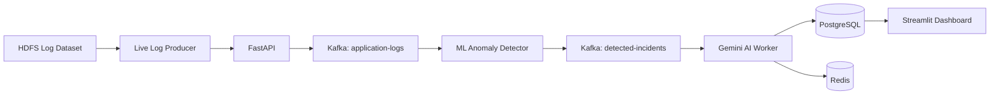

# AI-Powered Cloud Log Monitoring and Incident Detection Service

A distributed log-monitoring platform that ingests system logs in real time, streams them through Apache Kafka, detects anomalies using machine learning, generates AI-assisted incident explanations, stores results in PostgreSQL, prevents duplicate processing with Redis, and displays incidents through a live Streamlit dashboard.

The complete system is containerized with Docker and deployed and tested on Kubernetes.

## Architecture



## Main Features

- Real-time log ingestion using FastAPI
- Event streaming through Apache Kafka
- Machine-learning anomaly detection using scikit-learn
- Logistic Regression model with balanced class weights
- 19 Event-ID-based model features
- AI incident summaries using Google Gemini
- PostgreSQL incident persistence
- Redis-based duplicate incident prevention
- Live Streamlit monitoring dashboard
- Docker and Docker Compose deployment
- Kubernetes orchestration with persistent storage
- Health checks and readiness/liveness probes
- Kubernetes resource monitoring with Metrics Server
- Horizontal scaling and performance testing

## Technology Stack

| Layer | Technology |
|---|---|
| API | Python, FastAPI |
| Streaming | Apache Kafka |
| Machine Learning | scikit-learn, Logistic Regression |
| AI Analysis | Google Gemini |
| Database | PostgreSQL |
| Cache / Deduplication | Redis |
| Dashboard | Streamlit |
| Containers | Docker, Docker Compose |
| Orchestration | Kubernetes |
| Monitoring | Kubernetes Metrics Server |
| Dataset | Loghub HDFS logs |

## Project Structure

```text
ai-log-monitoring/
├── ai_worker/
│   └── incident_consumer.py
├── anomaly_detector/
│   ├── model/
│   ├── live_detector.py
│   └── train_model.py
├── api/
│   └── main.py
├── dashboard/
│   └── app.py
├── database/
│   └── init.sql
├── data/
│   └── training/
├── k8s/
│   ├── namespace.yaml
│   ├── configmap.yaml
│   ├── postgres.yaml
│   ├── redis.yaml
│   ├── kafka.yaml
│   ├── api.yaml
│   ├── detector.yaml
│   ├── aiworker.yaml
│   └── dashboard.yaml
├── producer/
│   ├── live_producer.py
│   └── live_producer_100k.py
├── screenshots/
├── Dockerfile.api
├── Dockerfile.detector
├── Dockerfile.aiworker
├── Dockerfile.dashboard
├── docker-compose.yml
├── requirements.txt
└── .env.example
```

## Environment Setup

Create the local environment file:

```bash
cp .env.example .env
```

Add a valid Gemini API key and configure the PostgreSQL password in `.env`.

The actual `.env` file is excluded from Git.

## Python Setup

```bash
python3 -m venv venv
source venv/bin/activate
pip install -r requirements.txt
```

## Docker Compose Deployment

Start the stateful services first:

```bash
docker compose up -d kafka postgres redis
```

Initialize PostgreSQL:

```bash
cat database/init.sql | \
docker exec -i postgres \
psql -U logadmin -d logmonitoring
```

Start the application services:

```bash
docker compose up -d api detector aiworker dashboard
```

Verify:

```bash
docker compose ps
```

FastAPI health check:

```bash
curl http://localhost:8000/health
```

Dashboard:

```text
http://localhost:8501
```

## Kubernetes Deployment

Create and select the namespace:

```bash
kubectl apply -f k8s/namespace.yaml
kubectl config set-context --current --namespace=ai-log-monitoring
```

Apply configuration:

```bash
kubectl apply -f k8s/configmap.yaml
```

Create the Kubernetes secret without storing credentials in Git:

```bash
kubectl create secret generic ai-log-secrets \
  --from-literal=GEMINI_API_KEY="$(grep '^GEMINI_API_KEY=' .env | cut -d= -f2-)" \
  --from-literal=POSTGRES_PASSWORD="$(grep '^POSTGRES_PASSWORD=' .env | cut -d= -f2-)"
```

Deploy PostgreSQL, Redis, and Kafka:

```bash
kubectl apply -f k8s/postgres.yaml
kubectl apply -f k8s/redis.yaml
kubectl apply -f k8s/kafka.yaml
```

Initialize PostgreSQL:

```bash
cat database/init.sql | \
kubectl exec -i postgres-0 -- \
psql -U logadmin -d logmonitoring
```

Create the Kafka topics:

```bash
kubectl exec kafka-0 -- \
/opt/kafka/bin/kafka-topics.sh \
--create \
--topic application-logs \
--bootstrap-server kafka:29092 \
--partitions 1 \
--replication-factor 1
```

```bash
kubectl exec kafka-0 -- \
/opt/kafka/bin/kafka-topics.sh \
--create \
--topic detected-incidents \
--bootstrap-server kafka:29092 \
--partitions 1 \
--replication-factor 1
```

Deploy the application:

```bash
kubectl apply -f k8s/api.yaml
kubectl apply -f k8s/detector.yaml
kubectl apply -f k8s/aiworker.yaml
kubectl apply -f k8s/dashboard.yaml
```

Verify:

```bash
kubectl get pods
```

Expected components:

```text
api
detector
aiworker
dashboard
kafka
postgres
redis
```

## Access the Kubernetes Application

FastAPI:

```bash
kubectl port-forward service/api 8000:8000
```

Dashboard:

```bash
kubectl port-forward service/dashboard 8501:8501
```

Then open:

```text
http://localhost:8501
```

## End-to-End Processing Flow

A log passes through the following pipeline:

```text
Log Producer
    ↓
FastAPI
    ↓
Kafka: application-logs
    ↓
Machine Learning Detector
    ↓
Kafka: detected-incidents
    ↓
Gemini AI Worker
    ↓
PostgreSQL + Redis
    ↓
Streamlit Dashboard
```

The Kubernetes end-to-end test successfully detected an anomalous DataNode event, generated a Gemini incident analysis, stored the incident in PostgreSQL, recorded the block in Redis, and displayed the incident on the dashboard.

## Kubernetes Scaling Results

Both tests used:

```text
Total requests: 500
Concurrency: 20
Traffic path: Kubernetes Service → FastAPI
```

| Metric | 1 API Pod | 2 API Pods |
|---|---:|---:|
| Successful Requests | 500 / 500 | 500 / 500 |
| Failed Requests | 0 | 0 |
| Total Time | 2.45 s | 0.99 s |
| Throughput | 204.12 req/s | 505.18 req/s |
| Average Latency | 96.86 ms | 38.45 ms |
| P50 Latency | 34.70 ms | 23.40 ms |
| P95 Latency | 348.80 ms | 74.63 ms |
| Pod Crashes | 0 | 0 |

Horizontal scaling from one API pod to two API pods significantly increased throughput while reducing response latency, with a 100% request success rate in both tests.

## Resource Monitoring

Kubernetes Metrics Server was used to monitor pod and node CPU and memory usage during performance testing.

During the two-pod test, the Kubernetes node remained healthy while processing more than 500 requests per second.

## Security

Sensitive configuration is not committed to Git.

The repository excludes:

```text
.env
venv/
Kafka runtime data
PostgreSQL backups
Redis backups
local Docker volumes
```

Kubernetes secrets are created separately from the local `.env` file.

## Dataset

The project uses HDFS log data from the public Loghub dataset.

The training workflow uses structured HDFS events and anomaly labels to train the anomaly detector.

## Future Improvements

Possible extensions include:

- Managed Kubernetes deployment
- Kafka multi-broker clustering
- Horizontal Pod Autoscaling
- Prometheus and Grafana observability
- Additional anomaly-detection models
- Automated incident alerting
- Authentication and role-based dashboard access

## Final Status

The system has been successfully tested with:

- Docker
- Docker Compose
- Kubernetes
- Persistent PostgreSQL and Redis storage
- Kafka streaming
- ML anomaly detection
- Gemini incident analysis
- End-to-end incident processing
- Kubernetes resource monitoring
- Performance testing
- Horizontal API scaling

The complete application runs locally as a distributed Kubernetes-based log monitoring and incident detection platform.
